<div align="center">

<!-- Hero Animated SVG Banner -->


<br />
<br />

# FESTFLOW
### Autonomous WhatsApp Event Registration, Dynamic Ticketing & Verification Engine

[](#)
[](#)
[](#)
[](#)
[](#)
[](#)

<p align="center">
  <a href="#-interactive-demo--live-flow"><b>Watch Live Simulation</b></a> •
  <a href="#-architecture-at-a-glance"><b>System Architecture</b></a> •
  <a href="#-core-modules"><b>Engine Modules</b></a> •
  <a href="#-quickstart"><b>Deploy in 5 Mins</b></a> •
  <a href="#-gate-scanner-pwa"><b>Gate Admission PWA</b></a>
</p>

---

</div>

## 🌐 The Problem & The Solution

| Traditional College Fest Setup | The FestFlow Autonomous Engine |
| :--- | :--- |
| ❌ Chaotic Google Forms with unverified responses | ⚡ **Automated conversational WhatsApp state machine** |
| ❌ Manual volunteer checks for fake UPI screenshots | 🔍 **Tesseract OCR extracts 12-digit UTR in &lt; 1.5s** |
| ❌ Screenshot sharing & replay fraud across teams | 🛡️ **Atomic database locks prevent duplicate payments** |
| ❌ Delayed faculty approval for On-Duty (OD) passes | 📲 **Instant mentor WhatsApp intimation with YES/NO dispatch** |
| ❌ Physical paper tickets easily lost or faked | 🎟️ **HMAC-SHA256 cryptographically signed passes with QR** |
| ❌ Slow gate queues requiring internet connectivity | 📱 **Offline zero-dependency admission scanner PWA** |

---

## 📱 Interactive Demo & Live Flow

Here is how the automated conversational engine interacts with attendees in real-time over WhatsApp:

<div align="center">
  
</div>

---

## 🏗️ Architecture at a Glance

FestFlow connects the WhatsApp Multi-Device protocol with an atomic database layer, cryptographic pass rendering, and offline admission:

```text
                                  ┌───────────────────────────┐
                                  │ Incoming WhatsApp Message │
                                  └─────────────┬─────────────┘
                                                │
                                    Baileys WebSocket Stream
                                                │
                                                ▼
                                  ┌───────────────────────────┐
                                  │   Conversation State Hub  │
                                  │    (Sliding 30-min TTL)   │
                                  └─────────────┬─────────────┘
                                                │
                        ┌───────────────────────┴───────────────────────┐
                        ▼                                               ▼
            [ TRACK A: Host Students ]                      [ TRACK B: External Delegates ]
            • Free Host Pass                                • Event Selection & Fee Calc
            • Roll Number Validation                        • Dynamic UPI VPA / QR
            • Mentor WhatsApp Dispatch                      • Tesseract OCR 12-Digit UTR
            • Automated OD Intimation                       • Atomic Supabase Duplicate Lock
                        │                                               │
                        └───────────────────────┬───────────────────────┘
                                                ▼
                                  ┌───────────────────────────┐
                                  │ Signed Digital Pass Maker │
                                  │  @napi-rs/canvas Engine   │
                                  │  [HMAC-SHA256 Token QR]   │
                                  └─────────────┬─────────────┘
                                                │
                                                ▼
                                  ┌───────────────────────────┐
                                  │   Physical Gate Scanner   │
                                  │  Zero-Dependency Web PWA  │
                                  │  (Instant Offline Verify) │
                                  └───────────────────────────┘
```

---

## 🧩 Core Engine Modules

### 1. 🤖 Conversational State Router (`src/stateMachine.js`)
- Full state machine routing with session isolation per phone number.
- Global instant escapes: typing `RESET`, `CANCEL`, `STATUS`, or `FAQ` triggers priority resolution without corrupting the active pipeline.
- Dynamic slot limit enforcement (`SOLD OUT` and `PAUSED` indicators directly pulled from [`config/events.json`](config/events.json)).

### 2. 🔍 Anti-Fraud OCR Transaction Verifier (`src/ocrVerifier.js`)
- Automatically ingests payment screenshots sent directly in the WhatsApp chat.
- Runs local image preprocessing and extracts the 12-digit Banking UTR code via regex: `\b[0-9]{12}\b`.
- Locks the UTR atomically in Supabase to eliminate payment replay attacks.

### 3. 🎟️ Cryptographic Pass Generator (`src/passGenerator.js`)
- Renders high-resolution digital passes with attendee photo, barcode, and event details via `@napi-rs/canvas`.
- Generates compact cryptographic tokens formatted as:
  ```text
  <RollNumber>.<EventID>.<Timestamp>.<HMAC-Signature>
  ```
- Prevents ticket tampering and fake screenshot forgery at campus entry gates.

### 4. 📲 Faculty Mentor OD Approval Loop (`src/mentorListener.js`)
- Dispatches formal OD approval cards directly to faculty mentors on WhatsApp.
- Mentors can approve or reject instantly by replying with:
  - `YES <RollNumber>`
  - `NO <RollNumber>`
  - `YES ALL` (Batch approval for entire student cohorts)
- Supabase updates in real-time and immediately pushes an alert notification to the student's phone.

### 5. 📱 Offline Gate Admission Scanner PWA (`web/scanner.html`)
- Standalone zero-dependency HTML5 progressive web app with camera barcode scanner.
- Validates HMAC signatures locally inside the browser using the Web Crypto API.
- Works 100% offline at gate checkpoints with zero lag even when college Wi-Fi is down.

---

## 🚀 Quickstart

### Step 1: Clone the Repository
```bash
git clone https://github.com/your-username/festflow.git
cd festflow
```

### Step 2: Install Dependencies
```bash
npm install
```

### Step 3: Configure Environment
Copy the template and fill in your Supabase & UPI credentials:
```bash
cp .env.example .env
```

```ini
# Supabase Database & Storage
SUPABASE_URL=https://your-project.supabase.co
SUPABASE_SERVICE_ROLE_KEY=your-service-role-key
SUPABASE_STORAGE_BUCKET=fest-passes

# Payment Routing
UPI_VPA=festorganizer@upi
UPI_PAYEE_NAME="Fest Organizing Committee"

# Cryptographic Token Signing
PASS_SIGNING_SECRET=your-64-character-hex-secret-key

# Institution Details
HOST_COLLEGE_NAME="Host Engineering College"
ADMIN_PHONE="910000000000"
```

### Step 4: Run Database Schema
Open your **Supabase Dashboard → SQL Editor** and run the contents of [`supabase/schema.sql`](supabase/schema.sql).

### Step 5: Start FestFlow!
```bash
npm start
```

---

## 🖥️ Terminal Control Center

FestFlow comes with an interactive CLI management console:

```text
┌   FESTFLOW // LIVE WHATSAPP ENGINE & MANAGEMENT CONSOLE
│
◇  Select Operational Task:
│  ● 1. Start 24/7 Live WhatsApp Listener (Mobile Pairing Code / Terminal QR)
│  ○ 2. Launch Interactive Terminal WhatsApp Simulator (Test Conversations Offline)
│  ○ 3. Spot Registration Desk Console (#SPOT Rapid Walk-in Entry)
│  ○ 4. Emergency Broadcast Dispatcher (Anti-Ban Rate Limited)
│  ○ 5. Dynamic Events & Pricing Configurator
│  ○ 6. WhatsApp Message Templates Customizer
│  ○ 7. Run Complete Automated System Verification Suite
└
```

---

## 🧪 Verification & Testing

Verify that all components (OCR, Canvas, Supabase, State Machine, HMAC) pass:

```bash
npm test
```

Test conversational flows offline in your terminal without WhatsApp:
```bash
node src/simulator.js
```

---

## 🛡️ Security & Privacy

- **Zero WhatsApp Cloud Dependencies:** FestFlow connects directly via WebSocket using Baileys without third-party SaaS middleman APIs.
- **Anti-Ban Architecture:** Implements randomized jitter delays (1200ms–2200ms), `composing` typing status updates, and emergency broadcast throttling (capped at 20 msgs/min).
- **Session Privacy:** Authentication keys are stored locally in `auth_info_baileys/` (strictly ignored by `.gitignore`).

---

## 📄 License

This project is licensed under the [MIT License](LICENSE).
<div align="center">
  <sub>Built for student hackathons, college symposiums, and production-scale campus festivals.</sub>
</div>
